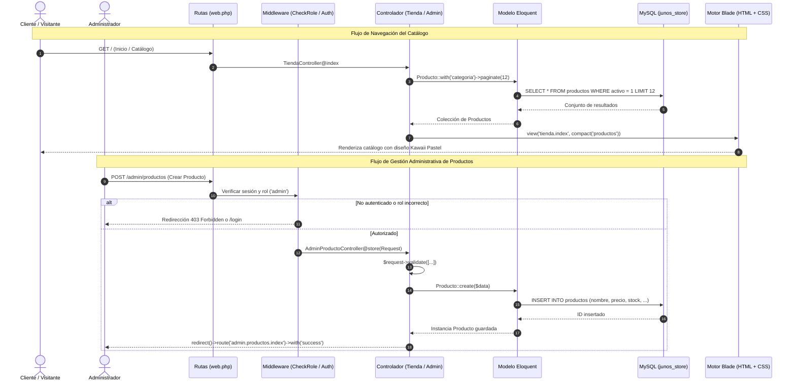

# 02. Tecnologías y Arquitectura del Sistema — Juno's Store

## 1. Stack Tecnológico y Versiones Detectadas
El proyecto combina herramientas modernas del entorno de desarrollo web en PHP con estándares de industria:

| Componente | Tecnología | Versión Detectada | Justificación y Función en el Proyecto |
| :--- | :--- | :---: | :--- |
| **Backend Core** | PHP (Hypertext Preprocessor) | `8.3.8` (CLI / Web) | Lenguaje base. Ofrece tipado estricto, atributos nativos, mejoras en rendimiento de ejecución (JIT) y sintaxis moderna. |
| **Framework Web** | Laravel Framework | `11.x` / `13.x` | Proporciona el núcleo MVC, el enrutador robusto, el motor de plantillas Blade, el ORM Eloquent y el sistema de inyección de dependencias. |
| **Motor de Base de Datos**| MySQL | `8.0` / `MariaDB` | Sistema gestor de bases de datos relacional (RDBMS) de alto rendimiento, con soporte ACID mediante el motor InnoDB. |
| **Servidor Local** | Laragon (Apache / Nginx) | `6.x` | Entorno de desarrollo aislado con PHP, MySQL, Composer y herramientas integradas para Windows. |
| **Gestor de Paquetes PHP**| Composer | `2.10.x` | Gestión de dependencias de Laravel y librerías auxiliares del framework. |
| **Empaquetador Frontend** | Vite | `5.x` | Servidor de desarrollo ultrarrápido y empaquetador de módulos CSS y JavaScript. |
| **Diseño / Maquetación** | CSS3 Nativo + Bootstrap | `5.3` (CDN) | Estilos personalizados kawaii pastel (`kawaii.css`, `home.css`, `login.css`) combinados con la grilla y componentes de Bootstrap. |
| **Iconografía** | FontAwesome 6 | `6.5.x` (CDN) | Íconos vectoriales para navegación, botones de acción, estados e indicadores visuales. |
| **Tipografía Web** | Google Fonts | Nunito / Inter | Fuentes sans-serif redondeadas y amigables que refuerzan la identidad estética kawaii/soft. |
| **Librería de Tablas** | DataTables.js | `1.13.7` + Plugins | Renderizado de tablas interactivas con ordenamiento, búsqueda en tiempo real y exportación (Excel, PDF, Impresión). |

---

## 2. Patrón Arquitectónico: Modelo - Vista - Controlador (MVC)

El sistema implementa estrictamente el patrón **Modelo-Vista-Controlador (MVC)**, el estándar fundamental en la ingeniería de software moderna para desacoplar responsabilidades:

```mermaid
graph TD
    User([Usuario / Navegador]) -->|1. Petición HTTP GET / POST| Router[Enrutador routes/web.php]
    Router -->|2. Filtro de Seguridad| Middleware[Middlewares: auth, role/admin]
    Middleware -->|3. Despacha acción| Controller[Controladores: TiendaController, AdminProductoController, UsuarioController]
    Controller -->|4. Consulta o muta datos| Model[Modelos Eloquent: Producto, Usuario, Categoria]
    Model <-->|5. Consultas SQL / PDO| DB[(Base de Datos MySQL: junos_store)]
    Model -->|6. Retorna Colecciones / Objetos| Controller
    Controller -->|7. Inyecta datos compact()| View[Vistas Blade: tienda.index, admin.productos.index]
    View -->|8. Renderiza HTML + CSS + JS| User
```

### Componentes del Patrón MVC en Juno's Store:

### 1. El Modelo (Model)
* **Ubicación:** `app/Models/` (`Producto.php`, `Usuario.php`, `Categoria.php`, `Subcategoria.php`, `Marca.php`, `Rol.php`, etc.).
* **Responsabilidad:** Representar las tablas de la base de datos `junos_store`. Encapsula la lógica de acceso a datos, reglas de negocio, mutadores/accesores de atributos, casts de tipos de datos (`decimal`, `boolean`, `integer`) y relaciones entre entidades mediante Eloquent ORM (`belongsTo`, `hasMany`).

### 2. La Vista (View)
* **Ubicación:** `resources/views/` (`tienda/`, `admin/`, `auth/`, `layouts/`).
* **Responsabilidad:** Presentación visual e interacción con el usuario. Las vistas son plantillas compiladas mediante **Laravel Blade**, que permiten heredar layouts maestros (`@extends`), definir bloques reutilizables (`@section`, `@yield`), escapar variables para prevenir ataques XSS (`{{ $producto->nombre }}`) y estructurar flujos lógicos simples (`@foreach`, `@if`, `@auth`).

### 3. El Controlador (Controller)
* **Ubicación:** `app/Http/Controllers/` (`TiendaController.php`, `AdminProductoController.php`, `AuthController.php`, `UsuarioController.php`).
* **Responsabilidad:** Actuar como mediador y cerebro del flujo. Recibe las peticiones HTTP (`Request $request`), ejecuta las validaciones de entrada, invoca métodos de los modelos o ejecuta consultas Eloquent, y finalmente decide la respuesta: renderizar una vista Blade enviando datos mediante `view('vista', compact('datos'))` o redireccionar al usuario con mensajes de retroalimentación en sesión `redirect()->route(...)->with('success', ...)`.

---

## 3. Comparación con la Metodología del Instructor

El análisis del proyecto de referencia del instructor revela una serie de principios metodológicos que han sido analizados e integrados en Juno's Store:

| Criterio Metodológico | Metodología del Instructor (Proyecto Referencia) | Juno's Store Tradicional (PHP) | Juno's Store Adaptado (Laravel) |
| :--- | :--- | :--- | :--- |
| **Control de Acceso / Roles** | Middleware dinámico `CheckRole` que recibe parámetros (`role:admin`, `role:vendedor`) | Validación manual con `$_SESSION['rol']` en la cabecera de cada archivo | Middleware estructurado en `bootstrap/app.php` y verificado en `routes/web.php` |
| **Operaciones CRUD** | Controladores con métodos RESTful estándar (`index`, `create`, `store`, `edit`, `update`, `destroy`) | Archivos PHP separados por acción (`guardar_producto.php`, `eliminar.php`) | Controladores de recurso centralizados con validación inyectada `Request $request` |
| **Edición de Registros** | Modales interactivos de Bootstrap en la misma vista listado | Redirección a formularios externos o recargas completas | Soporte dual: modales ágiles para cambios rápidos y vistas dedicadas para fichas extensas |
| **Listados Administrativos** | DataTables con ordenamiento, búsqueda y exportación a Excel, PDF e Impresión | Tablas HTML planas con paginación manual en SQL | Tablas estilizadas con DataTables.js adaptadas a la paleta suave pastel de la tienda |
| **Seguridad y Encriptación** | `Hash::make()` para contraseñas, directiva `@csrf` en formularios | `password_hash()` nativo en PHP con validaciones dispersas | Hash con algoritmo Bcrypt gestionado por Laravel y protección CSRF automática |
| **Auditoría de Registros** | Campos `created_by = auth()->id()`, marcas de tiempo y campo `estado` ('activo'/'inactivo') | Registros sin trazabilidad de quién ejecutó la acción | Inclusión de trazabilidad y gestión lógica de estados en modelos |

---

## 4. Diagrama del Flujo de Funcionamiento del Sistema

El siguiente diagrama detalla la interacción paso a paso cuando un usuario o administrador interactúa con la aplicación:



---

## 5. Justificación de las Decisiones de Diseño Técnico
1. **Conservación de la Base de Datos Existente:** Se configuraron los modelos Eloquent con `$primaryKey = 'id_producto'` o `'id_usuario'` y `$timestamps = false` mapeando constantes `CREATED_AT = 'creado_en'` y `UPDATED_AT = 'actualizado_en'`, garantizando que la migración a Laravel no destruya ni altere la estructura original de los datos existentes.
2. **Identidad Visual Kawaii sin Romper Funcionalidad:** Se centralizaron los estilos en archivos CSS externos modulares (`kawaii.css`, `home.css`, `login.css`) para evitar duplicaciones y mantener los colores suaves (lila, lavanda, rosa pastel) en todas las interfaces administrativas y de cara al cliente.
