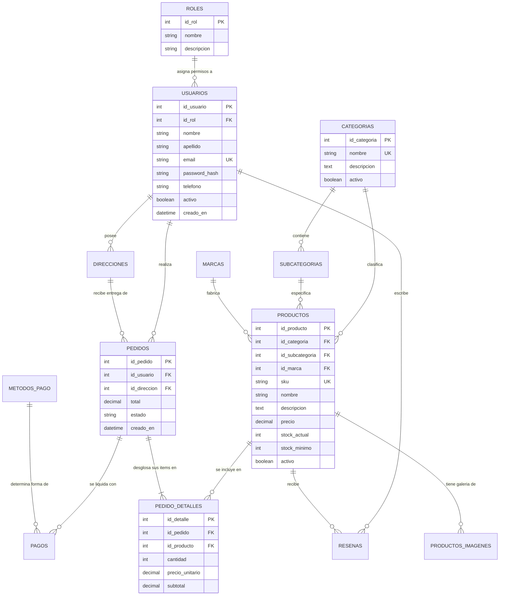

# 04. Base de Datos y Modelo Relacional — Juno's Store

## 1. Identificación de la Base de Datos
* **Nombre de la Base de Datos:** `junos_store`
* **Motor de Almacenamiento (Storage Engine):** `InnoDB` (garantiza transacciones ACID, integridad referencial mediante claves foráneas y bloqueo a nivel de fila).
* **Cotejamiento (Collation):** `utf8mb4_unicode_ci` (soporte completo para caracteres en español, tildes, signos de puntuación y emojis).
* **Gestión en Laravel:** Conexión configurada en `config/database.php` invocando las variables de entorno de `DB_CONNECTION`, `DB_HOST`, `DB_PORT` y `DB_DATABASE`.

---

## 2. Catálogo de Tablas del Sistema

| # | Nombre de la Tabla | Propósito y Función en Juno's Store | Clave Primaria | Claves Foráneas Relevantes | Modelo Eloquent Asociado |
| :-: | :--- | :--- | :--- | :--- | :--- |
| **1** | `roles` | Catálogo de roles de usuario (Administrador, Vendedor, Cliente). | `id_rol` | Ninguna | `App\Models\Rol` |
| **2** | `usuarios` | Datos de acceso y perfiles de usuarios registrados. | `id_usuario` | `id_rol -> roles(id_rol)` | `App\Models\Usuario` |
| **3** | `direcciones` | Direcciones de envío y facturación guardadas por los clientes. | `id_direccion` | `id_usuario -> usuarios(id_usuario)` | `App\Models\Direccion` |
| **4** | `categorias` | Categorías principales para clasificar los productos del catálogo. | `id_categoria` | Ninguna | `App\Models\Categoria` |
| **5** | `subcategorias` | Subgrupos específicos pertenecientes a una categoría padre. | `id_subcategoria` | `id_categoria -> categorias(id_categoria)` | `App\Models\Subcategoria` |
| **6** | `marcas` | Fabricantes o marcas comerciales de los artículos. | `id_marca` | Ninguna | `App\Models\Marca` |
| **7** | `productos` | Registro maestro de artículos a la venta, precios y stock. | `id_producto` | `id_categoria`, `id_subcategoria`, `id_marca` | `App\Models\Producto` |
| **8** | `productos_imagenes` | Múltiples fotografías por producto con marca de imagen principal. | `id_imagen` | `id_producto -> productos(id_producto)` | `App\Models\ProductoImagen` |
| **9** | `pedidos` | Cabecera de órdenes de compra realizadas por los clientes. | `id_pedido` | `id_usuario`, `id_direccion` | `App\Models\Pedido` |
| **10**| `pedido_detalles` | Líneas de producto, cantidades y precios unitarios por pedido. | `id_detalle` | `id_pedido`, `id_producto` | `App\Models\PedidoDetalle` |
| **11**| `metodos_pago` | Opciones de pago habilitadas (transferencia, tarjeta, contra entrega).| `id_metodo` | Ninguna | `App\Models\MetodoPago` |
| **12**| `pagos` | Comprobantes y transacciones financieras asociadas a pedidos. | `id_pago` | `id_pedido`, `id_metodo` | `App\Models\Pago` |
| **13**| `resenas` | Comentarios y puntuaciones de clientes sobre productos comprados. | `id_resena` | `id_producto`, `id_usuario` | `App\Models\Resena` |

---

## 3. Diagrama Entidad - Relación (DER)

El siguiente diagrama modela la arquitectura de datos real de Juno's Store, sus entidades y las cardinalidades de sus relaciones:



---

## 4. Descripción de Campos y Restricciones Principales

### Tabla `productos`
* `id_producto` (`INT UNSIGNED`, Auto Increment, Primary Key): Identificador único del artículo.
* `sku` (`VARCHAR(30)`, Unique, Nullable): Código de referencia de almacén (ej: `JUNO-102934`). Si se deja vacío en la creación, el controlador lo autogenera.
* `nombre` (`VARCHAR(180)`, Not Null): Nombre comercial legible del artículo.
* `precio` (`DECIMAL(10,2)`, Not Null): Valor monetario unitario. No admite números negativos.
* `stock_actual` (`INT`, Default 0): Unidades disponibles para la venta.
* `stock_minimo` (`INT`, Default 5): Umbral de alerta para reposición de inventario.
* `activo` (`TINYINT(1)`, Default 1): Bandera de borrado lógico / visibilidad en el catálogo público.
* Claves Foráneas:
  * `id_categoria` referencia a `categorias(id_categoria)` con regla `ON DELETE RESTRICT` (impide borrar una categoría que tenga productos asociados).
  * `id_subcategoria` referencia a `subcategorias(id_subcategoria)`.
  * `id_marca` referencia a `marcas(id_marca)`.

### Tabla `usuarios`
* `id_usuario` (`INT UNSIGNED`, Auto Increment, Primary Key): Identificador único.
* `id_rol` (`INT UNSIGNED`, Not Null): Llave foránea que determina los permisos del usuario.
* `email` (`VARCHAR(150)`, Unique, Not Null): Correo electrónico único usado como identificador de login.
* `password_hash` (`VARCHAR(255)`, Not Null): Hash criptográfico generado mediante Bcrypt (`Hash::make()`). Nunca se guarda texto plano.
* `activo` (`TINYINT(1)`, Default 1): Estado de la cuenta para permitir o suspender el acceso.

---

## 5. Consultas y Mutaciones con Eloquent ORM

En lugar de utilizar sentencias SQL dispersas con `mysqli_query()`, Laravel interactúa con `junos_store` mediante **Eloquent ORM**, ofreciendo una capa segura contra inyecciones SQL basada en sentencias preparadas de PDO:

### A. Eager Loading para Optimización de Rendimiento
Para evitar el problema de rendimiento conocido como **N+1 queries** (ejecutar una consulta por cada fila de una lista), Laravel carga relaciones en lote:
```php
// En AdminProductoController@index:
$productos = Producto::with(['categoria', 'subcategoria', 'marca'])
    ->orderBy('creado_en', 'desc')
    ->paginate(15);
```

### B. Mutación Segura de Datos con Mass Assignment Protection
Los modelos definen el atributo `$fillable` como lista blanca de columnas que pueden ser guardadas masivamente, previniendo ataques de inyección de parámetros en los formularios:
```php
// En AdminProductoController@store:
$data = $request->validated();
$producto = Producto::create($data);
```

### C. Transacciones Atómicas para Operaciones Críticas
Cuando se procesa una orden de compra que involucra insertar en `pedidos`, desglosar en `pedido_detalles` y descontar existencias en `productos`, se emplean transacciones:
```php
DB::transaction(function () use ($pedidoData, $items) {
    $pedido = Pedido::create($pedidoData);
    foreach ($items as $item) {
        $pedido->detalles()->create($item);
        Producto::where('id_producto', $item['id_producto'])->decrement('stock_actual', $item['cantidad']);
    }
});
```
Si ocurre un error en cualquier punto del bloque, la base de datos realiza un **Rollback** automático, garantizando que el inventario nunca quede inconsistente.
