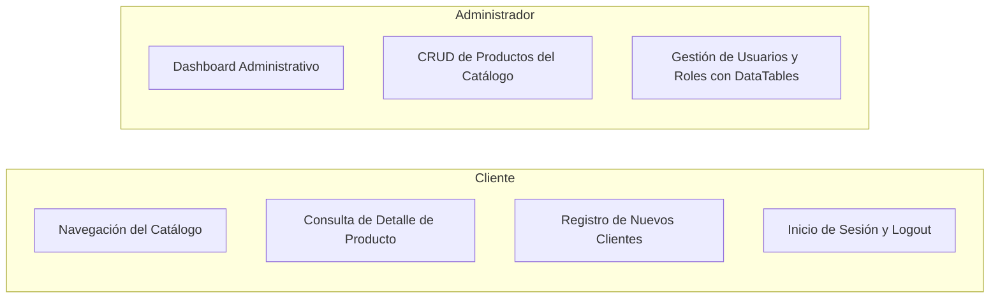

# 06. Funcionalidades y Flujos del Sistema — Juno's Store

## 1. Módulos Implementados en Juno's Store

A continuación se documentan las funcionalidades verificadas que operan en el sistema, describiendo el flujo completo de datos desde la interacción inicial del usuario hasta la persistencia en MySQL y la respuesta en pantalla:



---

## 2. Flujo 1: Navegación del Catálogo y Filtrado por Categoría

### Propósito
Permitir que visitantes y clientes registrados exploren los artículos disponibles en la tienda virtual de forma organizada, con paginación y filtrado temático.

### Flujo Operativo Paso a Paso:
1. **Acción del Usuario:** El usuario ingresa a la raíz del sitio web (`GET /`) o hace clic en un botón de filtro (ej: `GET /?categoria=3` para papelería kawaii).
2. **Recepción en Rutas:** `routes/web.php` intercepta la petición y la deriva al método `index()` de `TiendaController`.
3. **Procesamiento en el Controlador:**
   * Invoca `Categoria::activas()->get()` para renderizar los botones superiores de categorías.
   * Inicializa la consulta sobre `Producto` filtrando únicamente aquellos con `activo = 1`.
   * Si el parámetro `categoria` está presente en la URL, añade la cláusula SQL `.where('id_categoria', $id)`.
   * Ejecuta `paginate(12)` cargando con eager loading las imágenes principales de cada producto.
4. **Respuesta Visual:** El motor Blade procesa `resources/views/tienda/index.blade.php`, renderizando las tarjetas con su imagen, precio con formato monetario y botón de acceso a la ficha detallada.

---

## 3. Flujo 2: Consulta de Ficha Detallada de Producto

### Propósito
Brindar al usuario la información técnica, visual y de existencias de un producto específico antes de su compra.

### Flujo Operativo Paso a Paso:
1. **Acción del Usuario:** El cliente hace clic en "Ver Detalle" o en la imagen de una tarjeta en el catálogo (`GET /productos/{id}`).
2. **Controlador:** `TiendaController@show($id)`.
3. **Acceso a Datos:**
   * Ejecuta `Producto::with(['categoria', 'subcategoria', 'marca', 'imagenes'])->findOrFail($id)`. Si el ID no existe en la base de datos, Laravel lanza automáticamente una excepción `ModelNotFoundException` que retorna un error HTTP 404 estandarizado.
   * Realiza una consulta complementaria de hasta 4 productos de la misma categoría (`where('id_categoria', $producto->id_categoria)->where('id_producto', '!=', $id)->take(4)->get()`) para la sección de recomendaciones.
4. **Renderizado:** La vista `resources/views/tienda/detalle.blade.php` dibuja la galería de imágenes, la descripción completa, el stock disponible y la cuadrícula de artículos relacionados.

---

## 4. Flujo 3: Registro de Nuevos Clientes

### Propósito
Permitir que un nuevo usuario cree una cuenta personal para poder realizar compras y almacenar sus direcciones.

### Flujo Operativo Paso a Paso:
1. **Acción del Usuario:** El visitante accede a `/registro` y completa el formulario con: nombre, apellido, correo electrónico, teléfono, contraseña y confirmación de contraseña.
2. **Envío de Datos:** Al pulsar "Crear Cuenta", el formulario envía una petición `POST /registro` protegida por el token `@csrf`.
3. **Validación en `AuthController@registro`:**
   * `nombre`: Requerido, alfabético, máx 80 caracteres.
   * `email`: Requerido, formato de email válido y **único** en la tabla `usuarios`.
   * `password`: Requerido, mínimo 6 caracteres, coincidencia obligatoria con `password_confirmation`.
4. **Manejo de Errores de Validación:** Si alguna regla falla, Laravel interrumpe el flujo, redirige atrás conservando los datos previos (`withInput()`) y expone los mensajes de error en la directiva `@error`.
5. **Persistencia en Base de Datos:**
   * Si la validación es exitosa, se crea el registro en `usuarios`:
     ```php
     $usuario = Usuario::create([
         'id_rol' => 3, // Rol de Cliente
         'nombre' => $request->nombre,
         'apellido' => $request->apellido,
         'email' => strtolower($request->email),
         'password_hash' => Hash::make($request->password),
         'telefono' => $request->telefono,
         'activo' => 1,
         'email_verificado' => 0
     ]);
     ```
6. **Autenticación Inmediata y Redirección:** Laravel ejecuta `Auth::login($usuario)`, inicia la sesión y redirige al catálogo con un mensaje flash de bienvenida.

---

## 5. Flujo 4: Autenticación (Inicio de Sesión y Cierre de Sesión)

### Propósito
Verificar la identidad del usuario registrado, emitir una sesión segura y direccionar al panel adecuado según su rol.

### Flujo Operativo Paso a Paso:
1. **Petición:** El usuario envía sus credenciales mediante `POST /login`.
2. **Validación de Credenciales:** `AuthController@login` busca el registro por correo electrónico y evalúa el hash mediante `Hash::check($password, $usuario->password_hash)`.
3. **Control de Acceso:**
   * Si la contraseña no coincide o el correo no existe: retorna con error `withErrors(['email' => 'Credenciales incorrectas'])`.
   * Si el campo `activo` del usuario es 0: deniega el acceso con mensaje `Tu cuenta está inactiva`.
4. **Emisión de Sesión:**
   * Invoca `Auth::login($usuario, $remember)`.
   * Invoca `$request->session()->regenerate()` (medida esencial para prevenir ataques de Session Fixation).
5. **Enrutamiento por Rol:**
   * Si `$usuario->isAdmin()` es verdadero: redirige al dashboard administrativo (`route('admin.dashboard')`).
   * Si es cliente: redirige a la página principal (`route('tienda.index')`).
6. **Cierre de Sesión (`POST /logout`):** Destruye la sesión en servidor mediante `Auth::logout()`, invalida la sesión de PHP con `$request->session()->invalidate()` y regenera el token CSRF para proteger futuras interacciones.

---

## 6. Flujo 5: Gestión Administrativa de Productos (CRUD)

### A. Listado de Productos (`GET /admin/productos`)
* El middleware `admin` verifica que el usuario autenticado posea privilegios de administración.
* El controlador recupera los productos mediante `Producto::with(['categoria', 'subcategoria'])->orderBy('creado_en', 'desc')->paginate(15)`.
* La vista `admin/productos/index.blade.php` muestra la tabla de inventario con SKU, imagen miniatura, nombre, precio, stock actual y botones de acción (Editar, Eliminar).

### B. Creación de Producto (`POST /admin/productos`)
* El administrador completa el formulario en `admin/productos/crear.blade.php`.
* `AdminProductoController@store` valida los campos:
  * Verifica que `id_categoria` exista en la tabla `categorias`.
  * Si el `sku` no fue ingresado, se autogenera con el prefijo `JUNO-` y 6 dígitos aleatorios.
  * Valida que el `precio` y los stocks no sean negativos.
* Se persiste el registro y se redirige al listado con mensaje de confirmación en verde.

### C. Actualización de Producto (`PUT /admin/productos/{id}`)
* `AdminProductoController@update` recupera el producto con `findOrFail($id)`.
* Valida los datos entrantes; para el campo `sku` se aplica una regla de excepción: `'sku' => 'nullable|unique:productos,sku,' . $id . ',id_producto'`, permitiendo que el producto conserve su propio código sin arrojar falso positivo de duplicidad.
* Se guardan los cambios y se emite la notificación de éxito.

### D. Eliminación de Producto (`DELETE /admin/productos/{id}`)
* Ejecuta el borrado del registro o la conmutación de su bandera `activo = 0`.
* Se actualiza la vista inmediatamente reflejando el cambio.

---

## 7. Flujo 6: Gestión de Usuarios con DataTables (Metodología del Instructor)

### Propósito
Controlar el estado de los usuarios registrados, modificar sus roles y exportar listados para auditoría académica o administrativa.

### Flujo Operativo Paso a Paso:
1. **Acceso:** El administrador visita `/listausuarios`, protegido por `middleware(['auth', 'role:admin'])`.
2. **Carga Inicial:** `UsuarioController@index` obtiene todos los usuarios con su rol asociado mediante `User::with('role')->get()` y la lista completa de roles disponibles `Role::all()`.
3. **Renderizado Interactivo con DataTables:**
   * DataTables toma el control de la tabla HTML: agrega paginación por páginas de 10/25/50 registros, campo de búsqueda instantánea por cualquier columna y botones de exportación (Excel, PDF, Imprimir).
   * Se cargan selectores de filtro rápido por **Rol** (Administrador, Vendedor, Cliente) y por **Estado** (Activo, Inactivo).
4. **Edición mediante Modales de Bootstrap:**
   * Al hacer clic en "Editar" sobre cualquier fila, se despliega el modal `#exampleModal` o `#editModal{{ $id }}`.
   * El modal carga dinámicamente los datos del usuario en campos editables (nombre, correo, rol y estado).
   * El envío del formulario realiza una petición `PUT` hacia `/admin/usuarios/{id}`.
   * `UsuarioController@update` actualiza las propiedades del modelo y retorna `back()->with('success', 'Usuario actualizado exitosamente')`, recargando la tabla con la información actualizada sin perder la vista.
