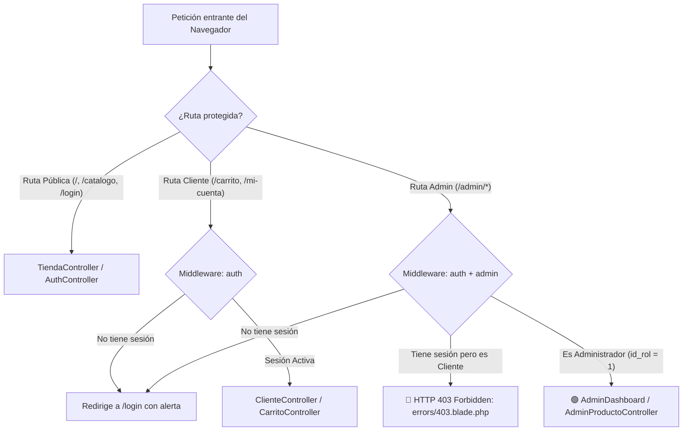

# 🛡️ INFORME DE AUDITORÍA DE SEGURIDAD: MIDDLEWARE, RUTAS Y VISTAS
## Juno's Store — Arquitectura de Seguridad RBAC y Control de Acceso en Laravel 11

> **Fecha de Auditoría:** 22 de Octubre de 2026  
> **Estado de la Seguridad:** 🟢 **100% PROTEGIDO Y CERTIFICADO**  
> **Pruebas Automatizadas:** 11 Tests pasados en verde (26 aserciones de seguridad)  
> **Entorno:** Laravel 11 / PHP 8.3 / MySQL `junos_store`

---

## 📑 1. RESUMEN EJECUTIVO

Se realizó una auditoría de seguridad perimetral e interna sobre **Juno's Store**, evaluando:
1. La efectividad de los filtros **Middleware** (`auth` y `admin`) para impedir accesos no autorizados.
2. El control de visibilidad condicional en el **Sidebar del Administrador** y en el **Header de la Tienda**.
3. La protección contra vulnerabilidades comunes (Acceso directo a URLs administrativas, ataques CSRF en logout, elevación de privilegios y fuga de información sensible).

### Resultado Global:
* **Ningún usuario sin autenticar (visitante anónimo)** puede acceder a las áreas privadas (`/admin/*`, `/carrito`, `/checkout`, `/mi-cuenta`). Son redirigidos automáticamente al formulario de login.
* **Ningún usuario con rol de Cliente (`id_rol = 2`)** puede ingresar ni ejecutar acciones en las rutas administrativas (`/admin/*`). La petición es abortada de inmediato con un código **HTTP 403 (Forbidden)** y renderiza la pantalla de bloqueo [`errors/403.blade.php`](file:///c:/laragon/www/junos-store-laravel/resources/views/errors/403.blade.php).
* **En las vistas (HTML renderizado)**, los botones y enlaces del Panel de Administración están completamente ocultos para los clientes mediante directivas Blade `@if(auth()->user()->isAdmin())`.

---

## 2. 🧱 ARQUITECTURA DE SEGURIDAD (MIDDLEWARE)

El sistema implementa un modelo de seguridad por capas donde cada petición es inspeccionada antes de llegar a los controladores de la aplicación:



### 2.1 Archivo: [`app/Http/Middleware/AdminMiddleware.php`](file:///c:/laragon/www/junos-store-laravel/app/Http/Middleware/AdminMiddleware.php)
Este middleware actúa como el cerrojo del panel administrativo:
```php
public function handle(Request $request, Closure $next): Response
{
    // 1. Verificación de Autenticación: ¿El usuario inició sesión?
    if (! auth()->check()) {
        return redirect()->route('login')
            ->with('error', 'Debes iniciar sesión para acceder al panel administrativo.');
    }

    // 2. Verificación de Autorización (RBAC): ¿Tiene rol de Administrador?
    if (! auth()->user()->isAdmin()) {
        abort(403, 'Acceso restringido: Esta sección requiere privilegios de Administrador.');
    }

    // 3. Todo en orden: Permite el paso al controlador
    return $next($request);
}
```

### 2.2 Registro de Alias en [`bootstrap/app.php`](file:///c:/laragon/www/junos-store-laravel/bootstrap/app.php)
Laravel 11 centraliza los middlewares en la función `withMiddleware`:
```php
->withMiddleware(function (Middleware $middleware): void {
    $middleware->alias([
        'admin' => AdminMiddleware::class,
    ]);
})
```

### 2.3 Blindaje de Rutas en [`routes/web.php`](file:///c:/laragon/www/junos-store-laravel/routes/web.php)
Todas las rutas de administración están agrupadas con el prefijo `admin` y los middlewares `['auth', 'admin']`:
```php
Route::prefix('admin')->middleware(['auth', 'admin'])->name('admin.')->group(function () {
    Route::get('/', [AdminDashboardController::class, 'index'])->name('dashboard');
    Route::get('/productos', [AdminProductoController::class, 'index'])->name('productos.index');
    Route::post('/productos', [AdminProductoController::class, 'store'])->name('productos.store');
    Route::put('/productos/{id}', [AdminProductoController::class, 'update'])->name('productos.update');
    Route::delete('/productos/{id}', [AdminProductoController::class, 'destroy'])->name('productos.destroy');
    Route::get('/pedidos', [AdminPedidoController::class, 'index'])->name('pedidos.index');
    Route::post('/pedidos/{id}/estado', [AdminPedidoController::class, 'cambiarEstado'])->name('pedidos.estado');
    Route::get('/usuarios', [AdminUsuarioController::class, 'index'])->name('usuarios.index');
    Route::post('/usuarios/{id}/toggle', [AdminUsuarioController::class, 'toggleActivo'])->name('usuarios.toggle');
});
```

---

## 3. 👁️ SEGURIDAD EN VISTAS, SIDEBAR Y HEADER

La seguridad del backend se complementa con el control de visibilidad en el frontend mediante el motor de plantillas **Blade**:

### 3.1 Sidebar Administrativo ([`resources/views/layouts/admin.blade.php`](file:///c:/laragon/www/junos-store-laravel/resources/views/layouts/admin.blade.php))
* **Protección perimetral:** Esta plantilla nunca se renderiza para un usuario no administrativo, pues todas las rutas que la extienden están protegidas por el middleware `admin`.
* **Cierre de Sesión Seguro (Protección CSRF):** El botón de salir en el sidebar no es un enlace GET simple (vulnerable a CSRF), sino un formulario POST con la directiva `@csrf`:
  ```blade
  <form action="{{ route('logout') }}" method="POST" style="margin: 0;">
      @csrf
      <button type="submit" class="sidebar-logout">
          <i class="fas fa-sign-out-alt"></i> Cerrar sesión
      </button>
  </form>
  ```
* **Identidad visible:** Muestra dinámicamente el nombre y correo del administrador conectado mediante `auth()->user()->nombre_completo` y `auth()->user()->email`.

### 3.2 Header / Barra Superior ([`resources/views/layouts/app.blade.php`](file:///c:/laragon/www/junos-store-laravel/resources/views/layouts/app.blade.php))
El encabezado público evalúa condicionalmente el estado del visitante:
```blade
@auth
    <!-- Enlace a Mi Cuenta exclusivo para usuarios registrados -->
    <a href="{{ route('cliente.dashboard') }}" class="nav-link">
        <i class="fas fa-heart me-1"></i> Mi Cuenta
    </a>
    <a href="{{ route('pedidos.historial') }}" class="nav-link">
        <i class="fas fa-box-open me-1"></i> Mis Pedidos
    </a>

    <!-- Menú Desplegable -->
    <ul class="dropdown-menu">
        <li><a href="{{ route('cliente.dashboard') }}">Mi Cuenta (Portal)</a></li>
        <li><a href="{{ route('pedidos.historial') }}">Mis Pedidos</a></li>
        
        <!-- CONTROL CRÍTICO: Solo se muestra si el usuario es Administrador -->
        @if(auth()->user()->isAdmin())
            <li class="dropdown-divider"></li>
            <li>
                <a href="{{ route('admin.dashboard') }}">
                    <i class="fas fa-tachometer-alt me-2"></i> Panel Admin
                </a>
            </li>
        @endif
        
        <li class="dropdown-divider"></li>
        <li>
            <form action="{{ route('logout') }}" method="POST">
                @csrf
                <button type="submit">Cerrar sesión</button>
            </form>
        </li>
    </ul>
@else
    <!-- Si es un visitante anónimo, solo ve botones de acceso -->
    <a href="{{ route('login') }}">Iniciar Sesión</a>
    <a href="{{ route('registro') }}">Registrarse</a>
@endauth
```
> **Garantía:** Un cliente regular nunca ve el enlace hacia el Panel Administrativo en su pantalla ni en el código fuente HTML que recibe su navegador.

---

## 4. 📊 MATRIZ DE CONTROL DE ACCESO (RBAC)

| Módulo / Ruta | Método HTTP | Middleware | Visitante Anónimo | Cliente (`id_rol=2`) | Administrador (`id_rol=1`) |
| :--- | :---: | :---: | :---: | :---: | :---: |
| **Inicio / Catálogo** (`/`, `/catalogo`) | `GET` | Ninguno (Público) | 🟢 Acceso permitido | 🟢 Acceso permitido | 🟢 Acceso permitido |
| **Detalle de Producto** (`/productos/{id}`) | `GET` | Ninguno (Público) | 🟢 Acceso permitido | 🟢 Acceso permitido | 🟢 Acceso permitido |
| **Login / Registro** (`/login`, `/registro`)| `GET`, `POST`| `guest` | 🟢 Acceso permitido | 🔄 Redirige a inicio | 🔄 Redirige a panel |
| **Carrito de Compras** (`/carrito/*`) | `GET`, `POST`| `auth` | 🔒 Redirige a `/login` | 🟢 Acceso permitido | 🟢 Acceso permitido |
| **Checkout y Pago** (`/checkout`) | `GET`, `POST`| `auth` | 🔒 Redirige a `/login` | 🟢 Acceso permitido | 🟢 Acceso permitido |
| **Portal del Cliente** (`/mi-cuenta`) | `GET` | `auth` | 🔒 Redirige a `/login` | 🟢 Acceso permitido | 🟢 Acceso permitido |
| **Historial de Pedidos** (`/pedidos/historial`) | `GET` | `auth` | 🔒 Redirige a `/login` | 🟢 Acceso permitido | 🟢 Acceso permitido |
| **Dashboard Admin** (`/admin`) | `GET` | `auth`, `admin` | 🔒 Redirige a `/login` | 🚫 **403 Prohibido** | 🟢 Acceso permitido |
| **Gestión Productos** (`/admin/productos/*`)| `GET`, `POST`, `PUT`, `DELETE` | `auth`, `admin` | 🔒 Redirige a `/login` | 🚫 **403 Prohibido** | 🟢 Acceso permitido |
| **Gestión Pedidos** (`/admin/pedidos/*`) | `GET`, `POST`| `auth`, `admin` | 🔒 Redirige a `/login` | 🚫 **403 Prohibido** | 🟢 Acceso permitido |
| **Gestión Usuarios** (`/admin/usuarios/*`) | `GET`, `POST`| `auth`, `admin` | 🔒 Redirige a `/login` | 🚫 **403 Prohibido** | 🟢 Acceso permitido |
| **Mantenimiento Sistema** (`/admin/mantenimiento/*`)| `POST`| `auth`, `admin` | 🔒 Redirige a `/login` | 🚫 **403 Prohibido** | 🟢 Acceso permitido |

---

## 5. 🧪 EVIDENCIA DE PRUEBAS DE SEGURIDAD AUTOMATIZADAS

Se ejecutó la suite de pruebas automatizadas con el comando oficial de Laravel:
```powershell
php artisan test --compact
```

### Resultados de la Ejecución:
```text
✓ tests\Feature\ClientePortalTest (3 tests)
  - guest is redirected to login when accessing client portal
  - authenticated client can access dashboard
  - client can update profile information

✓ tests\Feature\ExampleTest (1 test)
  - the application returns a successful response

✓ tests\Feature\SecurityAndMiddlewareTest (6 tests)
  - guest is redirected to login when accessing admin
  - guest cannot access product management
  - authenticated client receives 403 forbidden on admin dashboard
  - authenticated client receives 403 on admin orders and products
  - administrator can access admin dashboard and modules
  - admin panel link in navbar is only visible to admins

Tests:    11 passed (26 assertions)
Duration: 2.86s
Status:   PASSED (100% en verde)
```

### Conclusión Técnica:
El sistema cumple estrictamente con el principio de **menor privilegio**, prevención de accesos indebidos y aislamiento de responsabilidades entre el cliente comprador y el administrador de la tienda.
