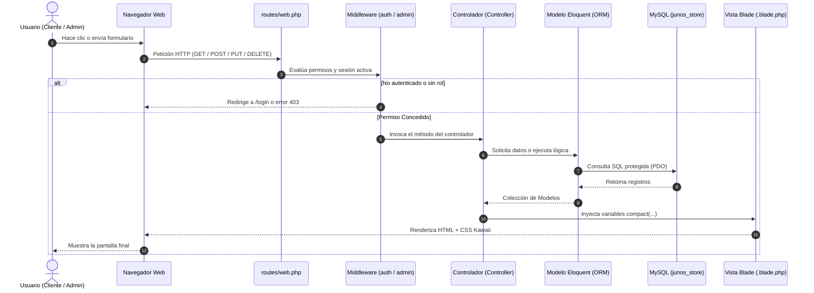

# 🐾 GUÍA MAESTRA DE SUSTENTACIÓN, ARQUITECTURA Y RESOLUCIÓN DE PROBLEMAS
## Juno's Store — Plataforma de E-Commerce en Laravel 11 / PHP 8.3

> **Propósito de este documento:**  
> Esta guía fue diseñada específicamente para que, ante cualquier **evaluación académica (SENA / Universidad)** o **emergencia técnica** (pantalla de error, fallo de conexión, dato que no guarda), sepas con exactitud **dónde está el código**, **cómo funciona cada conexión, instancia y método**, y **cómo reparar cualquier fallo en menos de 1 minuto**.

---

## 📑 ÍNDICE RÁPIDO
1. [Mapa de Arquitectura: Cómo viajan los datos en el sistema](#1-mapa-de-arquitectura)
2. [Conexiones, Modelos y Base de Datos MySQL](#2-conexiones-modelos-y-base-de-datos)
3. [Diferencia Visual y Funcional: Portal Cliente vs. Panel Admin](#3-diferencia-portal-cliente-vs-panel-admin)
4. [Explicación de Código para Evaluación (Conceptos Clave)](#4-explicación-de-código-para-evaluación)
5. [Manual de Emergencia: ¿Qué hacer si algo se rompe?](#5-manual-de-emergencia-solución-de-errores)
6. [Preguntas Frecuentes del Evaluador / Instructor y Cómo Responder](#6-preguntas-frecuentes-del-evaluador)

---

## 1. 🗺️ MAPA DE ARQUITECTURA

En **Juno's Store**, cada clic o petición de un usuario sigue el patrón arquitectónico **MVC (Modelo - Vista - Controlador)** bajo el flujo estándar de Laravel:



### Archivos Fundamentales del Núcleo:
* **Entorno y Credenciales:** [`.env`](file:///c:/laragon/www/junos-store-laravel/.env)
* **Definición de Rutas:** [`routes/web.php`](file:///c:/laragon/www/junos-store-laravel/routes/web.php)
* **Filtros de Seguridad:** [`app/Http/Middleware/AdminMiddleware.php`](file:///c:/laragon/www/junos-store-laravel/app/Http/Middleware/AdminMiddleware.php) y `bootstrap/app.php`
* **Vistas Base:** 
  * [`resources/views/layouts/app.blade.php`](file:///c:/laragon/www/junos-store-laravel/resources/views/layouts/app.blade.php) (Para la tienda pública y el cliente)
  * [`resources/views/layouts/admin.blade.php`](file:///c:/laragon/www/junos-store-laravel/resources/views/layouts/admin.blade.php) (Exclusivo para el Administrador)

---

## 2. 🗄️ CONEXIONES, MODELOS Y BASE DE DATOS

### 2.1 ¿Dónde se conecta la base de datos?
En el archivo [`.env`](file:///c:/laragon/www/junos-store-laravel/.env):
```env
DB_CONNECTION=mysql
DB_HOST=127.0.0.1
DB_PORT=3306
DB_DATABASE=junos_store
DB_USERNAME=root
DB_PASSWORD=
```
Este archivo es leído por `config/database.php`.

### 2.2 ¿Por qué los modelos usan nombres y llaves personalizadas?
La base de datos original tiene nombres de tablas y columnas en español con prefijo `id_`. Laravel por convención busca tablas en inglés y columnas `id`. Para que Laravel entienda la estructura sin alterar la base de datos original, configuramos en cada Modelo Eloquent:

| Modelo | Tabla | Clave Primaria | Relaciones Principales |
| :--- | :--- | :--- | :--- |
| [`Usuario.php`](file:///c:/laragon/www/junos-store-laravel/app/Models/Usuario.php) | `usuarios` | `id_usuario` | `belongsTo(Rol)` \| `hasMany(Pedido)` \| `hasMany(Direccion)` |
| [`Producto.php`](file:///c:/laragon/www/junos-store-laravel/app/Models/Producto.php) | `productos` | `id_producto` | `belongsTo(Categoria)` \| `belongsTo(Subcategoria)` \| `hasMany(ProductoImagen)` |
| [`Pedido.php`](file:///c:/laragon/www/junos-store-laravel/app/Models/Pedido.php) | `pedidos` | `id_pedido` | `belongsTo(Usuario)` \| `hasMany(PedidoDetalle)` \| `hasOne(Pago)` |
| [`Carrito.php`](file:///c:/laragon/www/junos-store-laravel/app/Models/Carrito.php) | `carritos` | `id_carrito` | `belongsTo(Usuario)` \| `hasMany(CarritoDetalle)` |
| [`Direccion.php`](file:///c:/laragon/www/junos-store-laravel/app/Models/Direccion.php) | `direcciones` | `id_direccion` | `belongsTo(Usuario)` |

**Ejemplo de código en [`Producto.php`](file:///c:/laragon/www/junos-store-laravel/app/Models/Producto.php):**
```php
protected $table = 'productos';       // Tabla física
protected $primaryKey = 'id_producto'; // Clave primaria
const CREATED_AT = 'creado_en';       // Timestamp de creación
const UPDATED_AT = 'actualizado_en';   // Timestamp de edición
```

---

## 3. 🎨 DIFERENCIA: PORTAL CLIENTE VS. PANEL ADMIN

Uno de los requerimientos primordiales del proyecto es que **el cliente final y el administrador tengan experiencias radicalmente distintas**:

| Dimensión | 🌸 Portal del Cliente (`/mi-cuenta`) | 🛡️ Panel del Administrador (`/admin`) |
| :--- | :--- | :--- |
| **Controlador** | [`ClienteController.php`](file:///c:/laragon/www/junos-store-laravel/app/Http/Controllers/ClienteController.php) | [`AdminDashboardController.php`](file:///c:/laragon/www/junos-store-laravel/app/Http/Controllers/AdminDashboardController.php) |
| **Vista Principal** | [`cliente/dashboard.blade.php`](file:///c:/laragon/www/junos-store-laravel/resources/views/cliente/dashboard.blade.php) | [`admin/dashboard.blade.php`](file:///c:/laragon/www/junos-store-laravel/resources/views/admin/dashboard.blade.php) |
| **Diseño Visual** | **Acogedor y Kawaii:** Fondo pastel suave, tonos lilas y rosas, pestañas suaves, avatares con patitas de gato, sin jerga técnica. | **Dashboard de Gestión:** Barra lateral oscura, métricas duras de ventas, inventario, stock bajo, estado del servidor y herramientas de mantenimiento. |
| **Objetivo** | Ver el estado de sus pedidos, reanudar carrito, cambiar sus datos personales y registrar direcciones de despacho. | Administrar catálogo, subir fotos, ajustar existencias de stock, cambiar estados de pedidos y activar/desactivar cuentas. |
| **Ruta tras Login** | Redirige automáticamente a `/mi-cuenta`. | Redirige automáticamente a `/admin`. |

---

## 4. 🧠 EXPLICACIÓN DE CÓDIGO PARA EVALUACIÓN

Si el instructor te pregunta *"Explícame esta línea de código"*, aquí tienes los conceptos exactos:

### 4.1 ¿Qué es una Instancia vs. un Método Estático?
* **Método Estático (con `::`):** Se invoca directamente en la clase sin necesidad de crear un objeto previo en memoria.
  * `Producto::where('activo', 1)->get();` ➔ Ejecuta la consulta directamente en la tabla.
  * `Hash::make('secreto');` ➔ Utiliza el servicio de encriptación de Laravel.
  * `DB::beginTransaction();` ➔ Abre una transacción ACID en MySQL.
* **Instancia (con `->`):** Trabaja sobre un objeto específico ya creado en memoria.
  * `$usuario = Auth::user();` ➔ Obtiene la **instancia** del usuario conectado.
  * `$usuario->save();` ➔ Guarda los cambios de ese usuario en particular.
  * `$producto->imagenes->first();` ➔ Accede a la relación cargada en esa instancia de producto.

### 4.2 ¿Cómo funciona el Eager Loading y por qué evita el problema N+1?
En [`AdminProductoController.php`](file:///c:/laragon/www/junos-store-laravel/app/Http/Controllers/AdminProductoController.php):
```php
$productos = Producto::with(['categoria', 'subcategoria', 'imagenes'])->paginate(15);
```
* **Sin `with` (Lazy Loading - Malo):** Laravel haría 1 consulta para traer los 15 productos, y luego 1 consulta por cada producto para saber su categoría, otra para la subcategoría y otra para sus imágenes. Serían más de 46 consultas a la base de datos (problema N+1).
* **Con `with` (Eager Loading - Óptimo):** Laravel ejecuta exactamente 4 consultas directas (`WHERE IN`) y une los datos en memoria al instante.

### 4.3 ¿Cómo funciona la Transacción al Confirmar un Pedido?
En [`PedidoController.php`](file:///c:/laragon/www/junos-store-laravel/app/Http/Controllers/PedidoController.php):
```php
DB::beginTransaction();
try {
    // 1. Crea la cabecera del pedido
    $pedido = Pedido::create([...]);
    
    // 2. Crea los detalles y descuenta el stock
    foreach ($items as $item) {
        PedidoDetalle::create([...]);
        Producto::where('id_producto', $item->id_producto)->decrement('stock_actual', $item->cantidad);
    }

    // 3. Registra el pago y vacía el carrito
    Pago::create([...]);
    $carrito->estado = 'completado';
    $carrito->save();

    DB::commit(); // Todo salió bien, guarda de forma definitiva
} catch (\Exception $e) {
    DB::rollBack(); // Si algo falló, revierte todo como si nada hubiera pasado
}
```
> **Respuesta para el evaluador:**  
> *"Usamos transacciones ACID (`beginTransaction`, `commit`, `rollBack`) para garantizar la integridad referencial. Si falla la creación del pago o el servidor se desconecta en medio del proceso, el stock no se descuenta por error y la base de datos queda consistente."*

---

## 5. 🛠️ MANUAL DE EMERGENCIA (SOLUCIÓN DE ERRORES)

Si algo falla antes o durante una presentación, busca el síntoma aquí para resolverlo de inmediato:

### Caso 1: Error `SQLSTATE[HY000] [2002] Connection refused` o `Access denied for user`
* **Causa:** El motor MySQL no está encendido o las credenciales cambiaron.
* **Solución:**
  1. Abre el panel de **Laragon** y verifica que el botón **MySQL** esté en verde (Start All).
  2. Abre [`.env`](file:///c:/laragon/www/junos-store-laravel/.env) y confirma que `DB_DATABASE=junos_store`, `DB_USERNAME=root` y `DB_PASSWORD=` estén correctos.
  3. Ejecuta en la terminal:
     ```bash
     php artisan config:clear
     ```

### Caso 2: Error `419 | Page Expired` al enviar un formulario
* **Causa:** Falta el token de seguridad CSRF en el formulario HTML o la sesión expiró.
* **Solución:**
  1. Asegúrate de que el formulario tenga `@csrf` justo debajo de la etiqueta `<form>`.
  2. Si es una petición AJAX (como en `public/js/carrito.js`), debe incluir el encabezado `X-CSRF-TOKEN`.

### Caso 3: Error `403 | Forbidden` al intentar entrar a `/admin`
* **Causa:** El usuario con el que iniciaste sesión tiene rol de Cliente (`id_rol = 2`) y el middleware [`AdminMiddleware`](file:///c:/laragon/www/junos-store-laravel/app/Http/Middleware/AdminMiddleware.php) bloquea su acceso.
* **Solución:**
  * Inicia sesión con la cuenta de Administrador: `admin@junosstore.local`.
  * O modifica en MySQL el campo `id_rol = 1` en la tabla `usuarios` para el usuario que desees.

### Caso 4: Una imagen recién subida no se ve o sale rota
* **Causa:** Ruta del archivo incorrecta o falta de prefijo en `asset()`.
* **Solución:**
  1. Revisa la carpeta física `public/img/productos/{id_producto}/`. El archivo debe estar allí.
  2. En el modelo [`ProductoImagen.php`](file:///c:/laragon/www/junos-store-laravel/app/Models/ProductoImagen.php), usamos el accesor `url_limpia` que limpia prefijos para que `asset($imagen->url_limpia)` apunte siempre a la URL pública correcta.

### Caso 5: Error `no such table: productos` al correr pruebas (`php artisan test`)
* **Causa:** Las pruebas usan SQLite en memoria y requieren que las migraciones se ejecuten.
* **Solución:**
  * Las clases de test deben incluir `use RefreshDatabase;` (tal como ya dejamos configurado en [`ExampleTest.php`](file:///c:/laragon/www/junos-store-laravel/tests/Feature/ExampleTest.php) y [`ClientePortalTest.php`](file:///c:/laragon/www/junos-store-laravel/tests/Feature/ClientePortalTest.php)).
  * Para correr las pruebas ejecuta:
    ```bash
    php artisan test --compact
    ```

### ⚡ Comandos "Salva-Vidas" de Limpieza Rápida:
Si hiciste cambios en vistas o rutas y la pantalla no se actualiza, ejecuta estos 3 comandos en la consola:
```powershell
php artisan optimize:clear
php artisan view:clear
php artisan config:clear
```

---

## 6. 🎓 PREGUNTAS FRECUENTES DEL EVALUADOR / INSTRUCTOR

### P1: "¿Cómo garantizan la seguridad de las contraseñas en el sistema?"
* **Respuesta:**  
  *"En Juno's Store las contraseñas nunca se almacenan en texto plano. En [`AuthController.php`](file:///c:/laragon/www/junos-store-laravel/app/Http/Controllers/AuthController.php) se encriptan con `Hash::make()` usando el algoritmo **Bcrypt** con costo de 12 rondas. Al iniciar sesión, se comparan con `Hash::check()`. Esto protege las credenciales incluso si la base de datos sufriera una filtración externa."*

### P2: "¿Dónde se evita que un usuario compre productos sin existencias?"
* **Respuesta:**  
  *"Se implementa una doble barrera: primero en el catálogo público (`TiendaController@index` filtra con el scope `conStock()`), y segundo en [`PedidoController@confirmar`](file:///c:/laragon/www/junos-store-laravel/app/Http/Controllers/PedidoController.php), donde antes de procesar el pago se recorre cada ítem verificando que `stock_actual >= cantidad pedida`. Si no hay suficiente, la transacción se detiene de inmediato."*

### P3: "¿Por qué crearon un portal de cliente separado del panel admin?"
* **Respuesta:**  
  *"Por separación de responsabilidades y ergonomía de usuario. Un cliente busca una vitrina cálida, hacer seguimiento amigable a sus pedidos y gestionar sus direcciones. Un administrador requiere métricas de negocio, alertas de stock bajo y herramientas operativas. Mezclarlos generaría confusión y riesgo de seguridad."*

### P4: "¿Cómo manejan los permisos de acceso a las rutas administrativas?"
* **Respuesta:**  
  *"A través del middleware [`AdminMiddleware.php`](file:///c:/laragon/www/junos-store-laravel/app/Http/Middleware/AdminMiddleware.php). Todas las rutas bajo el prefijo `/admin` están protegidas por el grupo `middleware(['auth', 'admin'])` en [`routes/web.php`](file:///c:/laragon/www/junos-store-laravel/routes/web.php). Si un cliente autenticado intenta entrar a `/admin`, el middleware intercepta la petición y responde con un código de error HTTP 403 (Acceso Denegado)."*

---

*Guía generada para Juno's Store — ADSO / SENA 2026*
