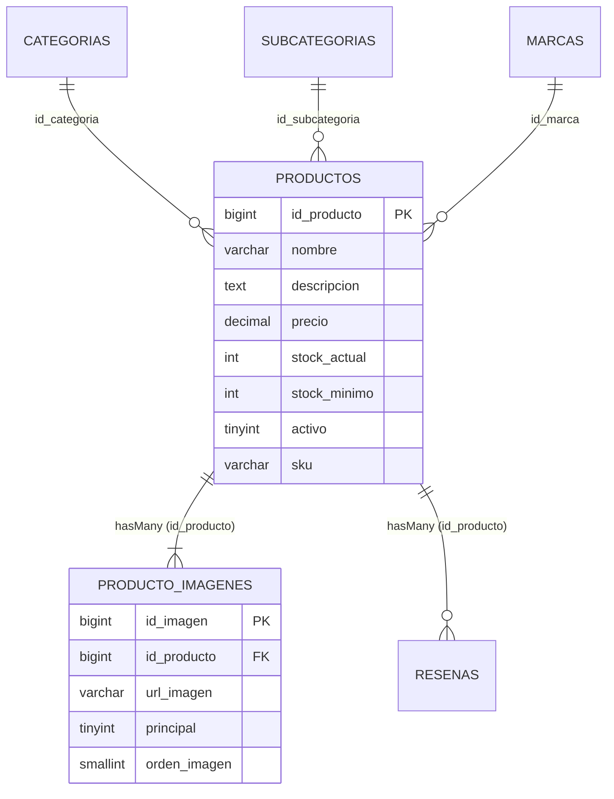

# 📦 Modelos Eloquent: `Producto.php` y `ProductoImagen.php` — Catálogo e Imágenes

## 1. Ficha Técnica

* **Ubicaciones:** 
  * `app/Models/Producto.php`
  * `app/Models/ProductoImagen.php`
* **Tipo:** Modelos Eloquent ORM (Mapeo Objeto-Relacional).
* **Capa:** Modelo / Datos (M en MVC).
* **Propósito:** Representar los registros de las tablas MySQL `productos` y `producto_imagenes`. Gestionar sus relaciones (1 a N), scopes de consulta, conversiones de tipo (`$casts`), asignación masiva protegida (`$fillable`) y accesores dinámicos para compatibilidad de rutas de imagen.

---

## 2. Diagrama de Relaciones Eloquent



---

## 3. Código Fuente y Explicación Detallada: `Producto.php`

```php
<?php

namespace App\Models;

use Illuminate\Database\Eloquent\Model;

class Producto extends Model
{
    // 1. Configuración de tabla y clave primaria personalizada
    protected $table = 'productos';
    protected $primaryKey = 'id_producto';

    // 2. Control de marcas de tiempo en español
    public $timestamps = false;
    const CREATED_AT = 'creado_en';
    const UPDATED_AT = 'actualizado_en';

    // 3. Lista blanca contra Mass Assignment
    protected $fillable = [
        'nombre', 'descripcion', 'precio',
        'id_categoria', 'id_subcategoria', 'id_marca',
        'sku', 'stock_actual', 'stock_minimo', 'activo',
    ];

    // 4. Casteo automático de tipos primitivos
    protected $casts = [
        'precio' => 'decimal:2',
        'stock_actual' => 'integer',
        'stock_reservado' => 'integer',
        'stock_minimo' => 'integer',
        'activo' => 'boolean',
    ];

    // 5. Relaciones Eloquent
    public function categoria()
    {
        return $this->belongsTo(Categoria::class, 'id_categoria', 'id_categoria');
    }

    public function subcategoria()
    {
        return $this->belongsTo(Subcategoria::class, 'id_subcategoria', 'id_subcategoria');
    }

    public function marca()
    {
        return $this->belongsTo(Marca::class, 'id_marca', 'id_marca');
    }

    public function imagenes()
    {
        return $this->hasMany(ProductoImagen::class, 'id_producto', 'id_producto');
    }

    public function resenas()
    {
        return $this->hasMany(Resena::class, 'id_producto', 'id_producto');
    }

    // 6. Scopes Locales de Consulta
    public function scopeActivos($query)
    {
        return $query->where('activo', 1);
    }

    public function scopeConStock($query)
    {
        return $query->where('stock_actual', '>', 0);
    }
}
```

### Puntos Clave de `Producto.php`:
1. **Clave Primaria No Estándar (`id_producto`):** Por defecto, Laravel asume que la clave es `id`. Al declarar `protected $primaryKey = 'id_producto';`, métodos como `find()`, `findOrFail()` y los enlaces de ruta funcionan automáticamente con el esquema existente.
2. **Scopes Locales (`scopeActivos`, `scopeConStock`):** Permiten encadenar consultas limpias en los controladores:
   `Producto::activos()->conStock()->paginate(12);`
   Esto centraliza la lógica de negocio evitando repetir `where('activo', 1)->where('stock_actual', '>', 0)` en múltiples archivos.
3. **Casts (`'activo' => 'boolean'`):** Convierte el `TINYINT(1)` de MySQL en un booleano estricto de PHP (`true`/`false`).

---

## 4. Código Fuente y Explicación Detallada: `ProductoImagen.php`

```php
<?php

namespace App\Models;

use Illuminate\Database\Eloquent\Model;

class ProductoImagen extends Model
{
    protected $table = 'producto_imagenes';
    protected $primaryKey = 'id_imagen';
    public $timestamps = false;

    protected $fillable = [
        'id_producto', 'ruta_imagen', 'url_imagen',
        'es_principal', 'principal', 'orden',
        'orden_imagen', 'texto_alternativo',
    ];

    protected $casts = [
        'es_principal' => 'boolean',
        'principal' => 'boolean',
    ];

    public function producto()
    {
        return $this->belongsTo(Producto::class, 'id_producto', 'id_producto');
    }

    // ACCESORES DE COMPATIBILIDAD
    public function getRutaImagenAttribute()
    {
        return $this->attributes['ruta_imagen'] ?? $this->attributes['url_imagen'] ?? null;
    }

    public function getEsPrincipalAttribute()
    {
        return (bool) ($this->attributes['principal'] ?? $this->attributes['es_principal'] ?? false);
    }

    public function getUrlLimpiaAttribute()
    {
        $raw = $this->ruta_imagen;
        if (! $raw) {
            return null;
        }

        // Remover prefijo /public/ si viene de la migración PHP anterior
        return preg_replace('#^/?public/#', '/', $raw);
    }
}
```

### Innovación Técnica en `ProductoImagen.php`:
* **El Problema Original:** La base de datos original de MySQL almacenaba los nombres de columna `url_imagen` y `principal` con valores como `/public/img/productos/1/foto.jpg`. Si una vista invocaba `$imagen->ruta_imagen` o `asset($imagen->url_imagen)`, Laravel fallaba porque `public` es la raíz del servidor web, generando rutas inválidas como `http://localhost/public/img/...`.
* **La Solución con Accesores (`get*Attribute`):**
  * `ruta_imagen`: Devuelve de forma transparente el valor de `url_imagen` si `ruta_imagen` no está seteado.
  * `es_principal`: Normaliza `principal` a booleano.
  * `url_limpia`: Utiliza una expresión regular (`#^/?public/#`) para eliminar el prefijo `/public/`, permitiendo que `asset($imagen->url_limpia)` apunte con total precisión a los recursos estáticos.

---

## 5. Preguntas Frecuentes para Evaluación

1. **¿Qué es un Accesor en Eloquent y para qué se usó aquí?**
   * *Respuesta:* Un accesor es un método `get{Nombre}Attribute()` que intercepta la lectura de una propiedad en un modelo para formatearla antes de entregarla. Se utilizó `getUrlLimpiaAttribute()` para limpiar rutas heredadas de la base de datos sin necesidad de alterar físicamente los registros en MySQL.
2. **¿Cuál es la diferencia entre `$fillable` y `$guarded`?**
   * *Respuesta:* `$fillable` define una lista blanca explícita de campos que pueden asignarse masivamente (`create()` o `update()`). `$guarded` define una lista negra de campos protegidos. Se usa `$fillable` por mayor seguridad.
3. **¿Cómo se define una relación de uno a muchos (*One to Many*) entre Producto e Imágenes?**
   * *Respuesta:* En `Producto.php` mediante `$this->hasMany(ProductoImagen::class, 'id_producto', 'id_producto')` y en `ProductoImagen.php` con la relación inversa `$this->belongsTo(Producto::class, 'id_producto', 'id_producto')`.
