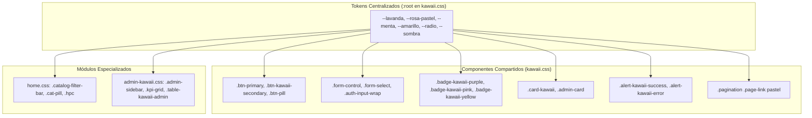

# 🎀 Sistema de Diseño Visual: `kawaii.css` y `admin-kawaii.css`

## 1. Ficha Técnica

* **Ubicaciones:**
  * `public/css/kawaii.css` (Diseño Global y Componentes Públicos)
  * `public/css/admin-kawaii.css` (Diseño del Panel Administrativo)
  * `public/css/home.css` (Buscador, Píldoras y Tarjetas del Home)
* **Tipo:** Hojas de Estilo en Cascada (CSS3 Nativo con Custom Properties y Flexbox/Grid).
* **Capa:** Vista / Capa Estilística (CSS).
* **Propósito:** Definir la identidad estética pastel, dulce y kawaii de Juno's Store. Garantiza armonía cromática entre la tienda pública y el panel de administración mediante tokens de diseño centralizados (`:root`), efectos de vidrio esmerilado (*glassmorphism*), sombras suaves y diseño 100% adaptable (*responsive*).

---

## 2. Mapa de Conexiones de Estilos



---

## 3. Tokens de Diseño Global (`:root`)

```css
:root {
    /* Paleta Pastel Oficial */
    --lavanda: #ded5f5;          /* Fondo suave y bordes */
    --lavanda-dark: #60458f;     /* Títulos principales y contrastes */
    --rosa-pastel: #f4a8bf;      /* Acentos dulces y botones destacados */
    --menta: #b8e5d1;            /* Indicadores positivos y stock disponible */
    --amarillo: #f8d98b;         /* Estrellas de reseñas y badges populares */
    --lila: #f1edfb;             /* Fondos secundarios de tarjetas */
    --blanco: #ffffff;           /* Superficies de tarjetas */
    --texto: #352b43;            /* Color de texto con alto contraste */
    --texto-claro: #81768d;      /* Subtítulos y metadatos */

    /* Geometría y Sombras */
    --radio: 16px;               /* Radio base de esquinas */
    --sombra: 0 12px 30px rgba(79, 59, 110, 0.12);
    --sombra-fuerte: 0 20px 48px rgba(79, 59, 110, 0.18);
}
```

### Principios de UI/UX Aplicados:
1. **Curvas Suaves (Border Radius):** Se emplean bordes redondeados (`16px`, `24px` y `999px` tipo píldora) para evocar una sensación tierna, accesible y amigable.
2. **Efecto Glassmorphism:**
   ```css
   background: rgba(255, 255, 255, 0.88);
   backdrop-filter: blur(14px);
   border: 1px solid rgba(222, 213, 245, 0.6);
   ```
   Añade profundidad tridimensional translúcida moderna sobre el fondo decorativo.
3. **Contraste Accesible (WCAG):** A pesar de la paleta pastel, los textos usan `--texto: #352b43` (un tono berenjena profundo) y `--lavanda-dark: #60458f`, garantizando un ratio de contraste superior a 4.5:1 exigido por las normas de accesibilidad web.

---

## 4. Componentes Clave Explicados

### A. Botones Pastel con Micro-interacciones
```css
.btn-primary {
    background: linear-gradient(135deg, #b66be8 0%, #8652ca 100%);
    border: none;
    border-radius: 999px;
    padding: .75rem 1.7rem;
    font-weight: 800;
    color: #fff;
    box-shadow: 0 8px 20px rgba(134, 82, 202, 0.3);
    transition: transform 0.2s ease, box-shadow 0.2s ease;
}

.btn-primary:hover {
    transform: translateY(-2px);
    box-shadow: 0 12px 26px rgba(134, 82, 202, 0.42);
}
```
* **Micro-animación:** El desplazamiento hacia arriba de 2 píxeles (`translateY(-2px)`) sumado a la intensificación de la sombra crea un efecto de "botón pulsable" altamente responsivo.

---

### B. Form Controles con Anillos de Foco Suaves (*Focus Rings*)
```css
.form-control:focus,
.form-select:focus {
    border-color: #9b84cc;
    box-shadow: 0 0 0 4px rgba(155, 132, 204, 0.2);
    background-color: #ffffff;
    outline: none;
}
```
* Reemplaza el recuadro azul genérico de los navegadores por un halo morado pastel suave (`rgba(155, 132, 204, 0.2)`), manteniendo la coherencia de marca mientras el usuario escribe.

---

### C. Tablas Administrativas Pastel (`.table-kawaii-admin`)
```css
.table-kawaii-admin {
    width: 100%;
    border-collapse: separate;
    border-spacing: 0;
}

.table-kawaii-admin th {
    background: #fbf9fe;
    color: #5c4484;
    font-size: 0.78rem;
    font-weight: 800;
    text-transform: uppercase;
    letter-spacing: 0.5px;
    padding: 1rem 1.25rem;
    border-bottom: 2px solid #ede7f8;
}

.table-kawaii-admin td {
    padding: 1rem 1.25rem;
    border-bottom: 1px solid #f2ecfb;
    background: #ffffff;
    transition: background 0.15s ease;
}

.table-kawaii-admin tr:hover td {
    background: #faf6ff;
}
```
* La fila se ilumina sutilmente con un tono lavanda casi imperceptible (`#faf6ff`) al pasar el cursor, facilitando la lectura de filas de datos extensas.

---

## 5. Preguntas Frecuentes para Evaluación

1. **¿Por qué se utilizan Variables CSS (`custom properties`) en `:root`?**
   * *Respuesta:* Facilitan la escalabilidad y mantenibilidad. Si se decide cambiar el tono morado de la marca, solo se modifica `--lavanda-dark` en la línea 9 de `kawaii.css` y todo el sitio (botones, enlaces, encabezados, bordes y tablas) se actualiza de manera sincronizada.
2. **¿Cómo se logró resolver el problema de imágenes y fondos rotos de la migración PHP?**
   * *Respuesta:* En el código PHP original existían rutas como `url('<?= BASE_URL ?>/img/background.jpeg')`. Como las hojas CSS son archivos estáticos que Laravel despacha directamente sin pasarlas por el motor de PHP, esas etiquetas no se interpretaban. Se sustituyeron por rutas web canónicas `/img/background.jpeg`.
3. **¿Cómo se garantiza que el diseño sea adaptable a dispositivos móviles (Responsive Design)?**
   * *Respuesta:* Se utilizan unidades fluidas (`clamp()`, `min(1180px, calc(100% - 2rem))`), Flexbox con `flex-wrap: wrap`, CSS Grid con `repeat(auto-fit, minmax(...))` y Media Queries `@media (max-width: 991px)` para colapsar la barra lateral del administrador y las columnas de productos.
