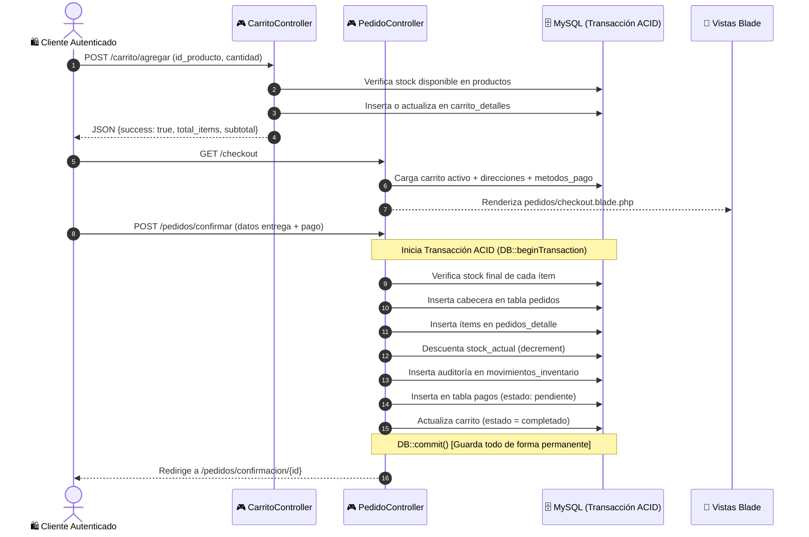

# 🛒 Archivo: `CarritoController.php` y `PedidoController.php` — Módulo Transaccional de Ventas y Checkout

## 1. Ficha Técnica

* **Ubicaciones:**
  * `app/Http/Controllers/CarritoController.php`
  * `app/Http/Controllers/PedidoController.php`
* **Tipo:** Controladores de Negocio y Transacciones de E-Commerce.
* **Capa:** Controlador / Lógica Transaccional (C en MVC).
* **Propósito:** Administrar el embudo de conversión completo de la tienda: gestión del carrito de compras activo, cálculo de subtotales y costos de despacho, validación de cupones de descuento, checkout de entrega, y orquestación de la orden de compra mediante **Transacciones ACID en MySQL** con descuento automático de stock y registro de auditoría.

---

## 2. Mapa de Conexiones y Flujo del Checkout



---

## 3. Código Fuente Crítico y Explicación Línea por Línea

### Bloque A: Transacción ACID al Confirmar Pedido (`PedidoController@confirmar`)

```php
// Iniciar transacción atómica en MySQL
DB::beginTransaction();

try {
    // 1. Crear la cabecera del pedido
    $pedido = Pedido::create([
        'id_usuario' => Auth::id(),
        'subtotal' => $subtotal,
        'descuento' => $descuento,
        'costo_envio' => $envio,
        'total' => $total,
        'estado' => 'pendiente',
        'direccion_entrega' => $direccionTexto,
        'notas' => $request->notas,
        'codigo_descuento_id' => $carrito->codigo_descuento_id,
    ]);

    // 2. Iterar items, registrar detalle y descontar stock
    foreach ($items as $item) {
        PedidoDetalle::create([
            'id_pedido' => $pedido->id_pedido,
            'id_producto' => $item->id_producto,
            'cantidad' => $item->cantidad,
            'precio_unitario' => $item->precio_unitario,
            'subtotal' => $item->cantidad * $item->precio_unitario,
        ]);

        // Descontar del inventario del producto de forma atómica
        Producto::where('id_producto', $item->id_producto)
            ->decrement('stock_actual', $item->cantidad);

        // Registrar trazabilidad en movimientos de inventario
        DB::table('movimientos_inventario')->insert([
            'id_producto' => $item->id_producto,
            'tipo_movimiento' => 'salida',
            'cantidad' => $item->cantidad,
            'motivo' => "Venta - Pedido #{$pedido->id_pedido}",
            'id_usuario' => Auth::id(),
            'creado_en' => now(),
        ]);
    }

    // 3. Crear registro del pago
    Pago::create([
        'id_pedido' => $pedido->id_pedido,
        'id_metodo_pago' => $metodoPagoId ?? 1,
        'monto' => $total,
        'estado' => 'pendiente',
        'fecha_pago' => now(),
    ]);

    // 4. Marcar carrito como completado para cerrarlo
    $carrito->estado = 'completado';
    $carrito->save();

    // 5. Confirmación total de la transacción
    DB::commit();

    return redirect()->route('pedidos.confirmacion', $pedido->id_pedido)
        ->with('success', '¡Tu pedido ha sido creado con éxito!');

} catch (\Exception $e) {
    // Si algo falló (caída de red, error de clave foránea), revertir todo
    DB::rollBack();
    return redirect()->route('carrito.index')
        ->with('error', 'Error al procesar el pedido: ' . $e->getMessage());
}
```

---

## 4. 💥 ANÁLISIS DE IMPACTO: "¿QUÉ SUCEDE SI QUITO ESTO EN EL PROYECTO?"

| Si quitas... | Error técnico que ocurre | Impacto real en el sistema |
| :--- | :--- | :--- |
| **`DB::beginTransaction()` y `DB::commit()`** | Ningún error si todo sale bien, pero si ocurre un fallo a mitad de camino... | **Corrupción de base de datos:** Si la inserción del pago o el guardado del carrito falla, el pedido ya se habrá creado y el stock ya se habrá descontado, dejando una venta incompleta, inconsistente y descuadrada financieramente. |
| **`Producto::where(...)->decrement('stock_actual', $item->cantidad)`** | Ningún error visible en pantalla. | **Venta de productos fantasma (Over-selling):** El stock nunca disminuye. Cien clientes podrían comprar el mismo peluche aunque en la bodega física solo exista uno, provocando quiebre de stock y reclamos masivos. |
| **La validación previa de stock `if ($stockDisponible < $item->cantidad)`** | `SQLSTATE[22003]: Numeric value out of range` (si la columna en MySQL es `UNSIGNED`). | Si el stock llega a valores negativos, MySQL bloquea la transacción o registra existencias irreales como `-4` peluches en inventario. |
| **`$carrito->estado = 'completado'`** | El carrito permanece en estado `'activo'`. | El cliente vuelve a entrar a `/carrito` y sus productos siguen allí cargados. Si le da clic en checkout de nuevo, creará pedidos duplicados sin querer. |
| **La verificación de pertenencia `if ($pedido->id_usuario !== Auth::id())` en `PedidoController@detalle`** | Vulnerabilidad de seguridad **IDOR** (Insecure Direct Object Reference). | Cualquier cliente conectado podría cambiar el número en la URL (ej. `/pedidos/1`, `/pedidos/2`) y ver los nombres, teléfonos y direcciones residenciales de todos los demás clientes de la tienda. |

---

## 5. ❓ ESCENARIOS DE CONTINGENCIA: "¿QUÉ PASA SI SUCEDE ESTO O AQUELLO?"

### Escenario 1: ¿Qué pasa si el servidor se apaga justo cuando se está ejecutando el bucle `foreach ($items)`?
* **Comportamiento:** Como la transacción aún no había alcanzado la instrucción `DB::commit()`, el motor **InnoDB de MySQL** descarta automáticamente todas las operaciones en memoria (`rollback` implícito). Cuando el sistema vuelve a encender, el stock no se descuenta por error y la base de datos queda intacta y consistente.

### Escenario 2: ¿Qué pasa si un usuario intenta aplicar un cupón de descuento que ya expiró?
* **Comportamiento:** En `CarritoController@aplicarDescuento`, se evalúa:
  ```php
  if ($codigo->fecha_fin && now()->gt($codigo->fecha_fin)) {
      return $this->jsonError('Este código de descuento ha expirado');
  }
  ```
  La API devuelve un mensaje de error y el carrito no sufre ninguna reducción de precio.

### Escenario 3: ¿Qué pasa si el subtotal supera el monto mínimo de envío gratis ($150.000 COP)?
* **Comportamiento:** La condición `($subtotal - $descuento) >= $montoMinEnvioGratis ? 0 : $costoEnvio` evalúa a `0`. En la vista de Checkout se dibuja el texto *"¡Envío Gratis! 🎀"* y el total a pagar disminuye en $8.000 COP.

---

## 6. 🛠️ POSIBLES PROBLEMAS, ERRORES COMUNES Y SOLUCIONES

### Problema 1: `Stock insuficiente para [Nombre del Producto]` al hacer checkout
* **Causa:** Otro comprador adquirió las últimas unidades disponibles mientras el usuario tenía la pantalla de checkout abierta.
* **Solución:** El validador de `PedidoController` detiene la compra antes de crear la orden y devuelve al cliente al carrito para que ajuste sus cantidades.

### Problema 2: El carrito no guarda productos y devuelve error 401
* **Causa:** El usuario intentó agregar un producto sin haber iniciado sesión.
* **Solución:** La ruta está protegida por `Route::middleware('auth')`. El frontend intercepta el 401 o redirige a `/login`.

---

## 7. 🎓 Preguntas Frecuentes para Evaluación

1. **¿Qué significa que una operación sea ACID en bases de datos?**
   * *Respuesta:* Significa que cumple con **Atomicidad** (o se hace todo o no se hace nada), **Consistencia** (la base de datos siempre pasa de un estado válido a otro), **Aislamiento** (dos transacciones no interfieren entre sí) y **Durabilidad** (una vez confirmado el `commit`, los datos persisten aunque se caiga el suministro eléctrico).
2. **¿Por qué se usa `decrement('stock_actual', $cantidad)` en vez de `$producto->stock_actual -= $cantidad; $producto->save();`?**
   * *Respuesta:* Por **seguridad contra condiciones de carrera (Race Conditions)**. `decrement()` ejecuta un `UPDATE productos SET stock_actual = stock_actual - ? WHERE id_producto = ?` a nivel atómico en el motor de base de datos MySQL, evitando que dos ventas simultáneas sobreescriban el valor desactualizado de la otra en memoria PHP.
3. **¿Cómo se calcula el costo de envío de forma dinámica?**
   * *Respuesta:* Se leen las constantes `SHIPPING_FREE_MIN` (150.000) y `SHIPPING_COST` (8.000) desde `config/constants.php`. Si el subtotal neto supera el límite, el costo de despacho se calcula automáticamente como 0.
