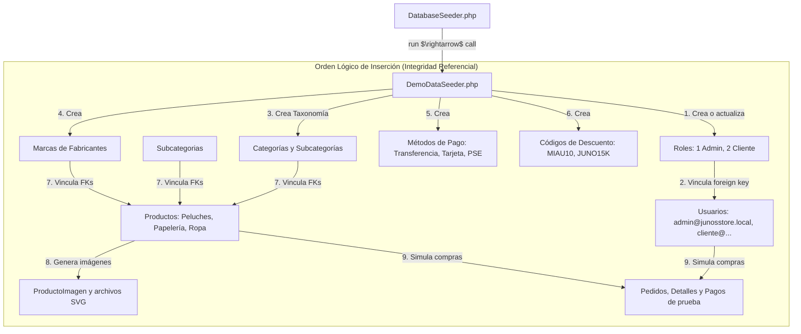

# 🌱 Archivo: `DatabaseSeeder.php` y `DemoDataSeeder.php` — Población y Semillas de Datos

## 1. Ficha Técnica

* **Ubicaciones:**
  * `database/seeders/DatabaseSeeder.php`
  * `database/seeders/DemoDataSeeder.php`
* **Tipo:** Clases Seeder de Laravel (Pobladores de Base de Datos).
* **Capa:** Base de Datos / Semillas (Database Layer).
* **Propósito:** Poblar la base de datos MySQL con información inicial, consistente, estética e idempotente para el funcionamiento inmediato del sistema: roles de acceso, usuarios de prueba (Admin y Clientes), categorías kawaii, marcas, métodos de pago, productos con existencias diferenciadas, cupones de descuento e imágenes visuales.

---

## 2. Mapa de Inyección y Dependencias de Datos



---

## 3. Código Fuente y Explicación Detallada

### 3.1 `DatabaseSeeder.php` — Orquestador Central
```php
<?php

namespace Database\Seeders;

use Illuminate\Database\Console\Seeds\WithoutModelEvents;
use Illuminate\Database\Seeder;

class DatabaseSeeder extends Seeder
{
    use WithoutModelEvents;

    public function run(): void
    {
        $this->call(DemoDataSeeder::class);
    }
}
```
* **`WithoutModelEvents`:** Desactiva temporalmente los eventos y observadores de modelos de Eloquent durante el sembrado masivo, acelerando drásticamente la velocidad de inserción y evitando bucles de eventos no deseados.
* **`$this->call(...)`:** Ejecuta el seeder detallado con todas las entidades.

---

### 3.2 Principio Clave de `DemoDataSeeder.php`: **Idempotencia con `updateOrCreate`**

```php
// Administrador Principal
$admin = Usuario::updateOrCreate(
    ['email' => 'admin@junosstore.local'], // Clave de búsqueda
    [
        'id_rol' => 1,
        'nombre' => 'Juno',
        'apellido' => 'Admin',
        'password_hash' => Hash::make('admin123'),
        'telefono' => '3001234567',
        'activo' => 1,
        'email_verificado' => 1,
        'ultimo_acceso' => now(),
    ]
);
```

#### ¿Por qué es una obra de arte de ingeniería?
* Si ejecutas el seeder 1 sola vez: Inserta los registros normalmente.
* Si ejecutas el seeder 10 veces seguidas: **NO genera duplicados ni errores de clave única** (`SQLSTATE[23000]`), sino que actualiza los valores existentes en MySQL.
* Esto permite que el administrador use el botón **"Cargar Datos de Prueba"** en el panel web cuantas veces quiera sin romper la base de datos.

---

## 4. 💥 ANÁLISIS DE IMPACTO: "¿QUÉ SUCEDE SI QUITO ESTO EN EL PROYECTO?"

| Si quitas... | Error técnico que ocurre | Impacto real en el sistema |
| :--- | :--- | :--- |
| **`updateOrCreate` y usas `create` directamente** | `SQLSTATE[23000]: Integrity constraint violation: 1062 Duplicate entry 'admin@junosstore.local' for key 'usuarios_email_unique'` | La segunda vez que corras `php artisan db:seed`, la terminal explotará con un error 500 y detendrá todo el proceso a la mitad. |
| **`Hash::make('admin123')` y guardas la contraseña en texto plano** | El seeder correrá bien, pero al intentar entrar a `/login`, `Hash::check` fallará siempre. | Ninguna persona podrá iniciar sesión con los usuarios creados por el seeder, bloqueando el acceso al sistema. |
| **`$this->call(DemoDataSeeder::class)` en `DatabaseSeeder.php`** | El comando `php artisan migrate:fresh --seed` terminará en 1 segundo pero la base de datos quedará totalmente vacía. | No existirá ningún rol ni usuario en el sistema. Al abrir el navegador, la tienda no mostrará productos y nadie podrá iniciar sesión como administrador. |
| **El orden de creación (ej. crear Productos antes que Categorías)** | `SQLSTATE[23000]: Integrity constraint violation: 1452 Cannot add or update a child row: a foreign key constraint fails` | MySQL rechaza la creación de productos si el `id_categoria` foráneo aún no existe en la tabla padre `categorias`. |

---

## 5. ❓ ESCENARIOS DE CONTINGENCIA: "¿QUÉ PASA SI SUCEDE ESTO O AQUELLO?"

### Escenario 1: ¿Qué pasa si el evaluador te dice: *"Reinicia la base de datos desde cero para ver qué pasa"*?
* **Comportamiento y Comando a ejecutar:**
  ```bash
  php artisan migrate:fresh --seed
  ```
  Laravel destruirá todas las tablas, volverá a crearlas con las migraciones y ejecutará `DemoDataSeeder`. En menos de 5 segundos la aplicación vuelve a tener productos, imágenes, compras de ejemplo y las cuentas `admin@junosstore.local` (clave `admin123`) y `cliente@junosstore.local` (clave `cliente123`) listas para operar.

### Escenario 2: ¿Qué pasa si no existen las fotos de los productos en `public/img/productos/`?
* **Comportamiento:** En `DemoDataSeeder.php`, el bloque de imágenes contiene un generador dinámico con `File::put(...)` que dibuja ilustraciones vectoriales SVG kawaii directamente en disco si la carpeta física no existe, garantizando que nunca veas imágenes rotas en el navegador.

---

## 6. 🛠️ POSIBLES PROBLEMAS, ERRORES COMUNES Y SOLUCIONES

### Problema 1: `Class "Database\Seeders\DemoDataSeeder" not found`
* **Causa:** El autoloader de Composer no indexó la clase nueva.
* **Solución:** Ejecutar en la consola:
  ```powershell
  composer dump-autoload
  ```

### Problema 2: El seeder se queda colgado o tarda demasiado
* **Causa:** Estás usando `Model::create` dentro de bucles muy grandes con eventos de modelo activos.
* **Solución:** `DatabaseSeeder` ya incluye `use WithoutModelEvents;` para acelerar las transacciones y reducir el consumo de RAM.

---

## 7. 🎓 Preguntas Frecuentes para Evaluación

1. **¿Qué diferencia hay entre una Migración y un Seeder?**
   * *Respuesta:* Una **Migración** define la **estructura** de la base de datos (tablas, columnas, tipos de datos, índices y llaves foráneas). Un **Seeder** define el **contenido** inicial o datos semilla (usuarios por defecto, roles, datos de catálogo).
2. **¿Qué credenciales de prueba genera este seeder para la sustentación?**
   * *Respuesta:*
     * **Administrador:** Correo `admin@junosstore.local` | Contraseña: `admin123` (Rol 1)
     * **Cliente 1:** Correo `cliente@junosstore.local` | Contraseña: `cliente123` (Rol 2)
     * **Cliente 2:** Correo `karen@junosstore.local` | Contraseña: `cliente123` (Rol 2)
3. **¿Qué códigos de descuento se pueden usar para probar el carrito?**
   * *Respuesta:*
     * `MIAU10`: 10% de descuento en el total.
     * `JUNO15K`: $15.000 COP de descuento fijo.
     * `PASTEL20`: 20% de descuento promocional.
